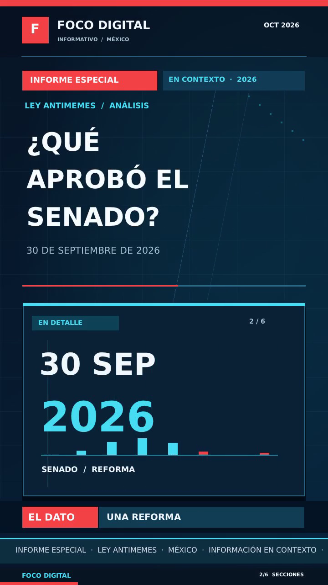

# HyperFrames C++

**An experimental C++17 renderer for a supported subset of HyperFrames-style HTML scene compositions.**

[](LICENSE)


> [!IMPORTANT]
> **Unofficial and experimental.** This is **not** the original HyperFrames engine, a browser implementation, or a general-purpose HTML/CSS/JavaScript-to-video converter. It understands a documented **subset** of scene markup. The C++ visual results are approximations, not pixel-perfect browser renders.

HyperFrames C++ reads supported HTML scene metadata (titles, subtitles, durations and accent colors), renders its own animated graphics, and writes AVI video with PCM audio. The executable does **not** invoke FFmpeg, Chromium, Node.js or Python at runtime.

## Preview

| News theme | Classic theme |
|:---:|:---:|
|  |  |
| Custom newsroom layout and scrolling ticker | Layout inspired by the example HTML |

*Screenshots are generated by this renderer, not by the official HyperFrames engine.*

## Features

- **Scene parser** for supported `<section class="scene">` elements, `data-start`, `data-duration`, `--a`, `wordline`, `kicker`, `sub`, and `barlabel`.
- **Two themes:** `classic` (reference-inspired) and `news` (an independent newsroom-style layout).
- **1–60 FPS**, with 24 FPS as default.
- **720 × 1280** vertical canvas (fixed for now).
- **Unicode TrueType** text using embedded DejaVu Sans, with antialiasing, kerning and Spanish diacritics.
- **Built-in AVI encoders:** MJPEG (default), 8-bit RLE, or uncompressed RGB24, with 24 kHz/16-bit mono PCM audio.
- **Statically linked** Linux and Windows x64 binaries via GCC and MinGW-w64.
- **No external video-rendering process** required by the executable.

### Current support

| Capability | Status |
|---|---|
| Read supported HTML scenes, timing, colors and text | Implemented |
| Render six known illustration types | Implemented |
| TrueType Unicode and two built-in themes | Implemented |
| AVI MJPEG / RLE8 / RGB24 with PCM audio | Implemented |
| 1–60 FPS | Tested on Linux |
| Windows x64 cross-compilation | Compiles; **not yet tested on Windows** |
| Arbitrary HTML, CSS layout or JavaScript | **Not supported** |
| Full GSAP timelines / accurate CSS transitions | **Not supported** |
| MP4 / H.264 generated by the C++ engine | **Not implemented** |
| Configurable resolution, arbitrary media/audio formats | **Not implemented** |

The output uses classic RIFF/AVI with a ~4 GiB file size limit. RGB24 can exceed this limit quickly; **MJPEG is recommended**. RLE8 uses a 256-color palette and visibly reduces color fidelity.

## Quick start

### Prerequisites

Build-time tools on Debian/Ubuntu:

```bash
sudo apt update
sudo apt install g++ python3 fonts-dejavu-core
# Optional: cross-compile the Windows x64 executable:
sudo apt install g++-mingw-w64-x86-64-win32
```

Clone and build:

```bash
git clone https://github.com/ThowiLabs/hyperframes-cpp.git
cd hyperframes-cpp
./scripts/build-linux.sh
# Optional:
./scripts/build-windows.sh
```

The build scripts embed locally installed DejaVu Sans font data in the executable. The generated `font_embedded.hpp` header and `.ttf` inputs are intentionally excluded from version control; they are **not needed at runtime**.

### Render your first video

Inspect the bundled sample (no video generation yet):

```bash
./hyperframes-linux --inspect samples/ley-antimemes/index.html
```

Create a 24 FPS vertical news composition **with silence**:

```bash
./hyperframes-linux samples/ley-antimemes/index.html - news.avi 24 mjpeg news
```

Generate synthetic WAV **test tones** and render a 60 FPS video:

```bash
python3 scripts/generate_demo_audio.py assets/audio
./hyperframes-linux samples/ley-antimemes/index.html assets/audio demo.avi 60 mjpeg classic
```

The generated clips are **only test signals**, not speech. For real narration, provide sequential `segment-01.wav`, `segment-02.wav`, etc. in a directory; each file must be **mono, 24 kHz, signed 16-bit PCM WAV**. There is one segment per HTML scene. Use `-` as the audio directory for silence.

Windows (from a Windows command prompt):

```bat
hyperframes-windows-x64.exe samples\ley-antimemes\index.html - news.avi 24 mjpeg news
```

### Command-line interface

```text
hyperframes-linux <composition.html> <audio-dir|-> <output.avi> [fps] [codec] [theme]
hyperframes-linux --inspect <composition.html>
```

| Argument | Accepted values | Default |
|---|---|---|
| `composition.html` | Supported scene-based HTML path | Required |
| `audio-dir` | Directory with sequential WAV clips, or `-` | Required |
| `output.avi` | Output AVI path | Required |
| `fps` | Integer 1–60 | 24 |
| `codec` | `mjpeg`, `rle8`, `rgb24` | `mjpeg` |
| `theme` | `news`, `classic` | `classic` |

### Scene markup

The importer recognizes **a limited set of markup conventions**, rather than arbitrary CSS layout or DOM elements:

```html
<section class="clip scene" data-start="0" data-duration="5"
         style="--a:#47DEF5">
  <div class="kicker">REPORT</div>
  <div class="wordline">An example headline</div>
  <div class="sub">A short explanation</div>
  <div class="barlabel">KEY TAKEAWAY</div>
</section>
```

Scene start times must be continuous. The current parser limits documents to 4 MiB, 64 scenes, and five minutes of total video; it expects the specific class conventions listed above. Some illustrations in the example are selected by class names (e.g. `dateart`, `ai-art`, `debate`) and mapped to built-in native drawings. It does **not** evaluate the CSS, `<script>` contents, or external GSAP animation data.

## Architecture

```text
HTML scene metadata ─┐
                     ├─> HTML importer ─> scene model ─> C++ scene renderer
WAV / silence ───────┘                               │
                                                     ├─> TrueType rasterizer
                                                     ├─> MJPEG / RLE8 / RGB24
                                                     └─> AVI muxer + PCM audio
```

| Path | Purpose |
|---|---|
| `main.cpp` | CLI, WAV reader, AVI muxing and codec selection |
| `html_composition.hpp` | Supported HTML scene importer |
| `render_scene.hpp` | Classic theme |
| `render_news.hpp` | News theme |
| `font_renderer.hpp` | UTF-8 decoding, TrueType metrics, text rendering |
| `avi_rle8.hpp` | Internal RLE8 encoder |
| `vendor/stb/` | Vendored stb TrueType and JPEG header-only code |
| `scripts/` | Font embedding, build scripts and synthetic audio fixtures |
| `tests/smoke-linux.sh` | Self-contained Linux smoke/integration tests |
| `samples/ley-antimemes/` | Demonstration of supported HTML conventions |

## Testing

```bash
./tests/smoke-linux.sh
```

The smoke test compiles a static Linux binary; verifies scene extraction, argument validation and malformed HTML rejection; changes sample HTML and checks that the video changes; and checks AVI output with the built-in codecs. If `ffprobe` is available, the test also verifies video/audio metadata. **FFprobe is never called by the renderer.**

> **Tip:** The demo output is an AVI file. To make an MP4 for browser playback, use a video converter **outside** the C++ renderer. Built-in native MP4 export is a future goal, not a feature of this release.

## Roadmap

- [ ] Broader HTML/CSS scene model with clear compatibility guarantees
- [ ] More motion-graphics components, transitions and GSAP-equivalent timing
- [ ] More flexible resolution and media inputs
- [ ] Native MP4 output without external tools
- [ ] Automated Windows runtime tests
- [ ] Better integration tests and comparison images

This project is an **experimental prototype**, not a drop-in replacement for [HyperFrames](https://github.com/HeyGen-Official/HyperFrames).

## Contributing

Contributions and reproducible bug reports are welcome. Please read [CONTRIBUTING.md](CONTRIBUTING.md) and [CODE_OF_CONDUCT.md](CODE_OF_CONDUCT.md). Describe which supported HTML elements your change affects, add tests where possible, and keep runtime dependencies out of the core executable.

## License and acknowledgements

Source code in this repository is licensed under the [Apache License 2.0](LICENSE), except third-party components and assets governed by their own terms.

- [stb](https://github.com/nothings/stb) headers by Sean Barrett and contributors are available under the public-domain / MIT dual-license terms.
- DejaVu Sans remains under its own license. The full applicable notice is in [assets/fonts/LICENSE.txt](assets/fonts/LICENSE.txt). Font files are **not committed**.
- The bundled scene example is derived from an HTML composition built using conventions from the upstream HyperFrames ecosystem. **HyperFrames is a separate project and is not affiliated with this repository.**

See [THIRD_PARTY_NOTICES.md](THIRD_PARTY_NOTICES.md) for details.

## Experimental compositor development branch

Development of a more general native engine takes place on [`develop/native-compositor`](https://github.com/ThowiLabs/hyperframes-cpp/tree/develop/native-compositor). The original `main` behavior is preserved until the newer engine has been fully reviewed.

The development branch adds frame-rate-independent easing timelines (`animation_timeline.hpp`), resizable 9:16 AVI output (`output_scale.hpp`) and **a deliberately small CSS px reader** (`css_properties.hpp`) for a handful of styles in the bundled example. It does **not** claim full CSS, GSAP, JavaScript or responsive layout support.

For example, build this branch and use an alternative vertical size:

```bash
./hyperframes-linux samples/ley-antimemes/index.html - news-360.avi 24 mjpeg news 360x640
./hyperframes-linux samples/ley-antimemes/index.html - news-1080.avi 30 mjpeg news 1080x1920
```

The optional last positional argument is `WIDTHxHEIGHT`, with even dimensions between 180x320 and 1080x1920, restricted to the 9:16 aspect ratio. **Internally the scene is still composed at 720x1280 and resampled**; this is not arbitrary aspect-ratio CSS layout. Other layouts will require a new scene compositor.

The classic theme now reads `.upper` top/left, `.kicker` height and font size, `.headline` font size/margin, `.sub` font size/margin, plus `.scene-N .headline` font-size overrides directly from the input `<style>` block. These are simple positive `px` rules only, not a standards-compliant CSS parser. CSS layout engines such as litehtml and raster backends such as Blend2D remain pending evaluation/integration.

Architecture and remaining work: [docs/ARCHITECTURE.md](docs/ARCHITECTURE.md) and [docs/ROADMAP.md](docs/ROADMAP.md). The smoke suite now also tests the animation timeline, CSS property parsing and changed CSS affecting an actual AVI render. Run it with `bash tests/smoke-linux.sh`.
